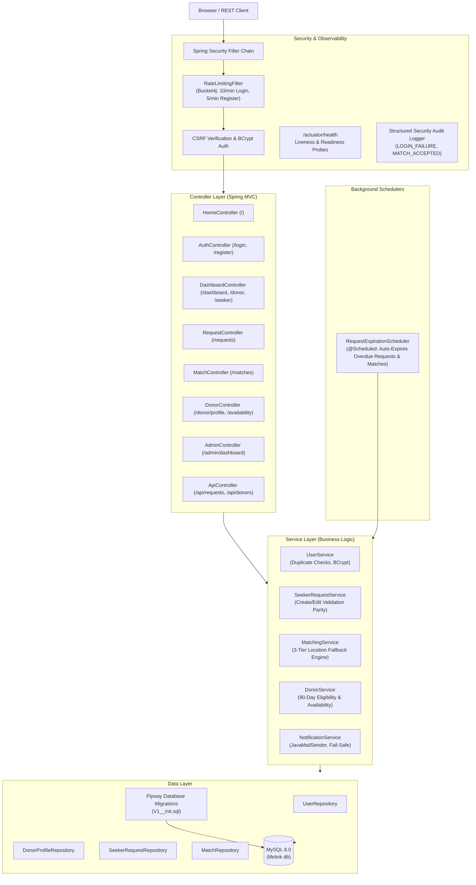

# LifeLink — Blood Donation Platform

A 100% Java Full-Stack blood donation matching platform built with **Java 21**, **Spring Boot 3.3.x**, **Thymeleaf**, **Spring Data JPA/Hibernate**, **Spring Security 6**, **Flyway**, and **MySQL**.

---

## 1. Architecture Overview

LifeLink follows a strict **Package-by-Layer** pattern. All form submissions are bound through validated Data Transfer Objects (DTOs), never directly to JPA entities. Controllers stay thin, while the domain business logic resides entirely in the service layer.



---

## 2. Tech Stack Overview

- **Language / Target**: Java 21 LTS
- **Core Framework**: Spring Boot 3.3.5 (Spring MVC, Data JPA, Security 6, Validation, Mail, Actuator)
- **View Layer**: Server-Rendered Thymeleaf with custom design system (`style.css`), responsive layouts, and zero external SPA dependencies
- **Database & Schema**: MySQL 8.0 with Flyway migrations (`spring.jpa.hibernate.ddl-auto=validate`)
- **Security**: Spring Security 6, BCrypt (cost factor 12), CSRF protection enforced everywhere, session fixation migration, Bucket4j rate limiting
- **Scheduling**: Spring `@EnableScheduling` running automated expiration sweeps every 15 minutes
- **Observability**: Spring Boot Actuator (`/actuator/health`), structured security audit logging
- **Containerization**: Multi-stage Docker build with Alpine JRE 21 and Docker Compose

---

## 3. Core Design Decisions Built In

1. **CSRF Protection ON Everywhere**: Never disabled on any route or form; CSRF tokens embedded in all forms and client fetch headers.
2. **Session Fixation Defense**: Enforces Spring Security's `migrateSession()` upon login.
3. **Password Policy**: Strict regex validation (`^(?=.*[a-z])(?=.*[A-Z])(?=.*\\d).{8,}$`) requiring minimum 8 characters with at least one uppercase letter, one lowercase letter, and one digit; hashed via BCrypt.
4. **Rate Limiting**: `RateLimitingFilter` applies Bucket4j token buckets per client IP (10 attempts/min on `POST /login`, 5 attempts/min on `POST /register`), returning `HTTP 429 Too Many Requests`.
5. **Canonical Match Acceptance**: Single `POST /matches/{requestId}/accept` endpoint with ownership check and atomic upsert semantics.
6. **Validation Parity for Blood Requests**: Creation and editing enforce identical business validation rules (units 1–20, required-by strictly in the future, non-blank hospital details).
7. **Privacy by Default**: Phone numbers and private contacts are hidden in public listings and alerts, disclosed **only** after mutual match acceptance (`contactShared = true`).
8. **Three-Tier Location-Aware Matching**:
   - *Tier 1 (City)*: Matches eligible donors in the exact same city.
   - *Tier 2 (State)*: If under 3 candidates, expands to the same state.
   - *Tier 3 (Nationwide)*: If still under 3 candidates, expands nationwide.
9. **Donor Eligibility**: Available to donate AND (no prior donation OR last donation $\ge 90$ days ago).
10. **Availability Cascading**: When a donor toggles available to `false`, all their `PENDING` matches immediately cascade to `EXPIRED`.
11. **Automated Scheduled Expiration**: Periodic background job auto-expires overdue `OPEN` requests and flips their `PENDING` matches to `EXPIRED`.
12. **Fail-Safe Notifications**: JavaMailSender notification failures are gracefully handled and never abort the database transaction.

---

## 4. Setup & Running Instructions

### Option A: Running via Docker Compose (Recommended)

Requires Docker Desktop or Docker Engine with Docker Compose.

1. **Build and start the complete stack (App + MySQL):**
   ```bash
   docker compose up --build
   ```

2. **Access the application:**
   - Web Platform: [http://localhost:8080](http://localhost:8080)
   - Health Probe: [http://localhost:8080/actuator/health](http://localhost:8080/actuator/health)
   - Seeded Admin: `admin` / `Admin@12345` (redirects to `/admin/dashboard`)

3. **Stop the stack:**
   ```bash
   docker compose down
   ```

---

### Option B: Running Locally with Maven & Local MySQL

#### 1. Prerequisites
- **Java 21 LTS** (`java -version`)
- **Maven 3.9+** (`mvn -v`)
- **MySQL 8.0** running locally on port 3306

#### 2. Create MySQL Database
```sql
CREATE DATABASE IF NOT EXISTS lifelink CHARACTER SET utf8mb4 COLLATE utf8mb4_unicode_ci;
```

#### 3. Configure Environment Variables (PowerShell example)
```powershell
$env:DB_HOST="localhost"
$env:DB_PORT="3306"
$env:DB_NAME="lifelink"
$env:DB_USERNAME="root"
$env:DB_PASSWORD="your_mysql_password"
$env:ADMIN_USERNAME="admin"
$env:ADMIN_PASSWORD="Admin@12345"
$env:ADMIN_EMAIL="admin@lifelink.org"
```

#### 4. Run the Application
```powershell
mvn spring-boot:run
```
Flyway automatically executes [`V1__init.sql`](file:///c:/yuvi/LifeLink/src/main/resources/db/migration/V1__init.sql), verifies schema tables, and starts the web server on port 8080.

---

## 5. Testing Suite

The project includes 109 automated tests spanning pure unit tests, Bean Validation tests, and full MockMvc integration tests using the isolated H2 test profile (`@ActiveProfiles("test")`).

```powershell
# Run the complete test suite
mvn clean test

# Run specific unit test suites
mvn test -Dtest=MatchingServiceUnitTest
mvn test -Dtest=DonorServiceUnitTest
mvn test -Dtest=SeekerRequestServiceUnitTest
mvn test -Dtest=PasswordPolicyValidationTest

# Run MockMvc flow and CSRF rejection integration tests
mvn test -Dtest=MockMvcFlowAndCsrfIntegrationTest
```

---

## 6. Observability & Security Audit Logging

### Health Probes (`/actuator/health`)
LifeLink exposes Spring Boot Actuator health checks accessible at:
```http
GET http://localhost:8080/actuator/health
```
Response:
```json
{
  "status": "UP",
  "components": {
    "db": {
      "status": "UP",
      "details": {
        "database": "MySQL",
        "validationQuery": "isValid()"
      }
    },
    "diskSpace": {
      "status": "UP"
    },
    "ping": {
      "status": "UP"
    }
  }
}
```

### Structured Security Audit Logs
Sensitive authentication and privacy-critical transitions emit structured audit entries:

- **Login Failure**:
  ```text
  [SECURITY_AUDIT] event=LOGIN_FAILURE username="attacker" ip="192.168.1.5" reason="Bad credentials"
  ```
- **Login Success**:
  ```text
  [SECURITY_AUDIT] event=LOGIN_SUCCESS username="john_donor" authorities="[ROLE_DONOR]"
  ```
- **User Registration**:
  ```text
  [SECURITY_AUDIT] event=USER_REGISTERED userId=14 username="alice_seeker" role="SEEKER"
  ```
- **Match Accepted (Contact Revealed)**:
  ```text
  [SECURITY_AUDIT] event=MATCH_ACCEPTED donorId=12 donorUsername="john_donor" requestId=5 matchId=42 contactShared=true seekerId=3
  ```
- **Match Declined**:
  ```text
  [SECURITY_AUDIT] event=MATCH_DECLINED donorId=12 requestId=5 matchId=42
  ```

---

## 7. Known Limitations & Future Work

### 7.1 Exact-Match Blood Group Logic (Design Decision #15)
In the current implementation of LifeLink, donor-to-seeker matching uses **exact blood group equality** (`donor.bloodGroup == request.bloodGroup`).

#### Clinical Reality vs. Deliberate System Simplification:
- In clinical transfusion medicine:
  - **O-Negative (O-)** is the universal donor for packed red blood cells (compatible with all ABO and Rh types).
  - **AB-Positive (AB+)** is the universal recipient for packed red blood cells (can safely receive blood from any ABO and Rh type).
  - **Rh Positive (+) recipients** can safely receive both Rh Positive (+) and Rh Negative (-) blood from compatible ABO groups (e.g., an `A+` patient can receive `A+`, `A-`, `O+`, and `O-`).
  - **Rh Negative (-) recipients** should only receive Rh Negative (-) units to avoid Rh immunization.
- **Why LifeLink Uses Exact-Match Equality:**
  - **Simplicity and Transparency**: Eliminates ambiguous clinical compatibility edge cases and keeps SQL queries deterministic and straightforward for interview and codebase auditability.
  - **Preventing O- Depletion**: In non-trauma situations, hospitals prefer giving type-identical blood to preserve scarce O- inventory for true emergency trauma resuscitations.
- **Path to Extension**:
  A compatibility matrix can be cleanly plugged into `MatchingService` without requiring schema migrations:
  ```java
  public enum BloodGroup {
      // Compatibility lookup returning set of acceptable donor groups for a recipient
      public Set<BloodGroup> getCompatibleDonorGroups() { ... }
  }
  ```
  The SQL queries in [`UserRepository`](file:///c:/yuvi/LifeLink/src/main/java/com/lifelink/repository/UserRepository.java) can then accept `Collection<BloodGroup> compatibleGroups` with an `IN (:compatibleGroups)` predicate.

### 7.2 Single-Node In-Memory Rate Limiting
- The Bucket4j filter uses an in-memory `ConcurrentHashMap`. In a multi-instance horizontally scaled deployment behind a load balancer, rate limits should be backed by Redis (`bucket4j-redis`) to share token buckets across nodes.

### 7.3 Direct SMTP Dispatch
- Email notifications run synchronously within `NotificationService` (with timeouts). In high-volume production systems, dispatching notifications through an asynchronous message broker (e.g., RabbitMQ, Kafka, or Spring `@Async`) decouples HTTP request threads from external SMTP latency.
