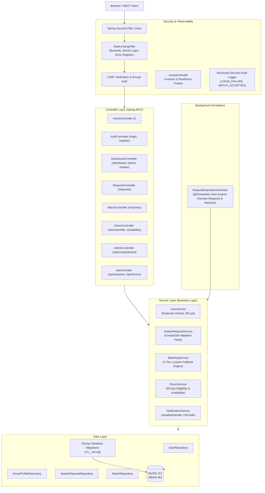

# LifeLink — Blood Donation Platform

A 100% Java Full-Stack blood donation matching platform built with **Java 21**, **Spring Boot 3.3.x**, **Thymeleaf**, **Spring Data JPA/Hibernate**, **Spring Security 6**, **Flyway**, and **MySQL**.

---

## Screenshots

| Home Page | Registration Flow |
|:---:|:---:|
|  |  |
| **Seeker Dashboard** | **Donor Hub** |
|  |  |
| **Admin Analytics & Telemetry** | **Mobile Responsive View (375px)** |
|  |  |

---

## 1. Architecture Overview

LifeLink follows a strict **Package-by-Layer** pattern. All form submissions are bound through validated Data Transfer Objects (DTOs), never directly to JPA entities. Controllers stay thin, while the domain business logic resides entirely in the service layer.



---

## 2. Tech Stack Overview

- **Language / Target**: Java 21 LTS
- **Core Framework**: Spring Boot 3.3.5 (Spring MVC, Data JPA, Security 6, Validation, Mail, Actuator)
- **View Layer**: Server-Rendered Thymeleaf with custom design system (`style.css`), responsive layouts, and zero external SPA dependencies
- **Database & Schema**: MySQL 8.0 with Flyway migrations (`spring.jpa.hibernate.ddl-auto=validate`)
- **Security**: Spring Security 6, BCrypt (cost factor 12), CSRF protection enforced everywhere, session fixation migration, Bucket4j rate limiting
- **Scheduling**: Spring `@EnableScheduling` running automated expiration sweeps every 15 minutes
- **Observability**: Spring Boot Actuator (`/actuator/health`), structured security audit logging
- **Containerization**: Multi-stage Docker build with Alpine JRE 21 and Docker Compose

---

## 3. Core Design Decisions Built In

1. **CSRF Protection ON Everywhere**: Never disabled on any route or form; CSRF tokens embedded in all forms and client fetch headers.
2. **Session Fixation Defense**: Enforces Spring Security's `migrateSession()` upon login.
3. **Password Policy**: Strict regex validation (`^(?=.*[a-z])(?=.*[A-Z])(?=.*\\d).{8,}$`) requiring minimum 8 characters with at least one uppercase letter, one lowercase letter, and one digit; hashed via BCrypt.
4. **Rate Limiting**: `RateLimitingFilter` applies Bucket4j token buckets per client IP (10 attempts/min on `POST /login`, 5 attempts/min on `POST /register`), returning `HTTP 429 Too Many Requests`.
5. **Canonical Match Acceptance**: Single `POST /matches/{requestId}/accept` endpoint with ownership check and atomic upsert semantics.
6. **Validation Parity for Blood Requests**: Creation and editing enforce identical business validation rules (units 1–20, required-by strictly in the future, non-blank hospital details).
7. **Privacy by Default**: Phone numbers and private contacts are hidden in public listings and alerts, disclosed **only** after mutual match acceptance (`contactShared = true`).
8. **Three-Tier Location-Aware Matching** (configured via `lifelink.matching.min-threshold=3` and `lifelink.matching.max-matches=25`):
   - *Tier 1 (City)*: Matches **all** eligible donors in the exact same city, up to the safety cap (`25`).
   - *Tier 2 (State, excluding city)*: Runs only if total matches `< 3`; matches all eligible donors in the same state, up to the safety cap (`25`).
   - *Tier 3 (Nationwide, excluding state)*: Runs only if total matches `< 3`; tops up only until the total reaches the minimum threshold (`3`).
9. **Donor Eligibility**: Available to donate AND (no prior donation OR last donation $\ge 90$ days ago).
10. **Availability Cascading**: When a donor toggles available to `false`, all their `PENDING` matches immediately cascade to `EXPIRED`.
11. **Automated Scheduled Expiration**: Periodic background job auto-expires overdue `OPEN` requests and flips their `PENDING` matches to `EXPIRED`.
12. **Fail-Safe Notifications**: JavaMailSender notification failures are gracefully handled and never abort the database transaction.

---

## 4. Setup & Running Instructions

### Option A: Running via Docker Compose (Recommended)

Requires Docker Desktop or Docker Engine with Docker Compose.

1. **Create your `.env` file from the template and set strong secrets:**
   ```bash
   cp .env.example .env
   ```
   Edit `.env` to set `MYSQL_ROOT_PASSWORD`, `DB_PASSWORD`, and `ADMIN_PASSWORD` (must be at least 8 characters with uppercase, lowercase, and a digit). The `mysql` service automatically derives its database name, app user, and app password from `DB_NAME`, `DB_USER`, and `DB_PASSWORD`. `docker-compose.yml` uses `${VAR:?message}` checks and will refuse to start if any required secret is missing.

   > **Note:** If a password contains `"$"` or other shell-special characters, wrap the value in single quotes in `.env`, for example `DB_PASSWORD='my$pass'`.

2. **Build and start the complete stack (App + MySQL):**
   ```bash
   docker compose up --build
   ```

3. **Access the application:**
   - Web Platform: [http://localhost:8080](http://localhost:8080)
   - Health Probe: [http://localhost:8080/actuator/health](http://localhost:8080/actuator/health)
   - Seeded Admin: `admin` / `<your ADMIN_PASSWORD from .env>` (redirects to `/admin/dashboard`)

4. **Stop the stack:**
   ```bash
   docker compose down
   ```

#### Docker Compose Environment Variable Mapping

| `.env` / Application Variable | Used By (`app` / `mysql`) | Expression in `docker-compose.yml`                          | Default in `application.properties` |
|-------------------------------|---------------------------|-------------------------------------------------------------|-------------------------------------|
| `DB_HOST`                     | `app`                     | `mysql`                                                     | `localhost`                         |
| `DB_PORT`                     | `app`                     | `3306`                                                      | `3306`                              |
| `DB_NAME`                     | `app` & `mysql`           | `${DB_NAME:-lifelink}`                                      | `lifelink`                          |
| `DB_USER`                     | `app` & `mysql`           | `${DB_USER:-lifelink}`                                      | *(none — required unless `dev`)*    |
| `DB_PASSWORD`                 | `app` & `mysql`           | `${DB_PASSWORD:?DB_PASSWORD must be set in .env}`           | *(none — required unless `dev`)*    |
| `MYSQL_ROOT_PASSWORD`         | `mysql`                   | `${MYSQL_ROOT_PASSWORD:?MYSQL_ROOT_PASSWORD must be set in .env}` | *(N/A — MySQL container root only)* |
| `ADMIN_PASSWORD`              | `app`                     | `${ADMIN_PASSWORD:?ADMIN_PASSWORD must be set in .env}`     | *(none — required unless `dev`)*    |

---

### Option B: Running Locally with Maven & Local MySQL

#### 1. Prerequisites
- **Java 21 LTS** (`java -version`)
- **Maven 3.9+** (`mvn -v`)
- **MySQL 8.0** running locally on port 3306

#### 2. Create MySQL Database
```sql
CREATE DATABASE IF NOT EXISTS lifelink CHARACTER SET utf8mb4 COLLATE utf8mb4_unicode_ci;
```

#### 3. Run with the Local `dev` Profile (Quickest for Local Development)
[`application-dev.properties`](src/main/resources/application-dev.properties) provides convenient local defaults (`root`/`root` for MySQL and a default dev admin password) and is activated **only** when `SPRING_PROFILES_ACTIVE=dev`:
```powershell
$env:SPRING_PROFILES_ACTIVE="dev"
mvn spring-boot:run
```
*(Or directly via Maven: `mvn spring-boot:run "-Dspring-boot.run.profiles=dev"`)*

#### 4. Or Run with Explicit Environment Variables (Production-like)
Without the `dev` profile, `DB_USER`, `DB_PASSWORD`, and `ADMIN_PASSWORD` have no fallback defaults and must be provided explicitly:
```powershell
$env:DB_HOST="localhost"
$env:DB_PORT="3306"
$env:DB_NAME="lifelink"
$env:DB_USER="root"
$env:DB_PASSWORD="your_db_password"
$env:ADMIN_USERNAME="admin"
$env:ADMIN_PASSWORD="YourStrongAdminPassword1"
$env:ADMIN_EMAIL="admin@lifelink.org"
mvn spring-boot:run
```
Flyway automatically executes [`V1__init.sql`](src/main/resources/db/migration/V1__init.sql), verifies schema tables, and starts the web server on port 8080.

---

## 5. Testing Suite

The project includes 183 automated tests spanning pure unit tests, Bean Validation tests, `ApplicationContextRunner` startup tests, asynchronous transaction event tests, and full MockMvc integration tests using the isolated H2 test profile (`@ActiveProfiles("test")`).

```powershell
# Run the complete test suite and verification lifecycle
mvn clean verify

# Run specific unit test suites
mvn test -Dtest=MatchingServiceUnitTest
mvn test -Dtest=DonorServiceUnitTest
mvn test -Dtest=SeekerRequestServiceUnitTest
mvn test -Dtest=PasswordPolicyValidationTest

# Run MockMvc flow and CSRF rejection integration tests
mvn test -Dtest=MockMvcFlowAndCsrfIntegrationTest
```

---

## 6. Observability & Security Audit Logging

### Health Probes (`/actuator/health`)
LifeLink exposes only the `health` endpoint (`management.endpoints.web.exposure.include=health`) and its liveness/readiness sub-paths (`/actuator/health/liveness`, `/actuator/health/readiness`):
```http
GET http://localhost:8080/actuator/health
```
- **Anonymous / Unauthenticated Probe Response** (used by Docker/Compose healthchecks):
  ```json
  {
    "status": "UP"
  }
  ```
- **Authenticated `ROLE_ADMIN` Response** (`management.endpoint.health.show-details=when-authorized`, `management.endpoint.health.roles=ADMIN`):
  ```json
  {
    "status": "UP",
    "components": {
      "db": {
        "status": "UP",
        "details": {
          "database": "MySQL",
          "validationQuery": "isValid()"
        }
      },
      "diskSpace": {
        "status": "UP"
      },
      "ping": {
        "status": "UP"
      }
    }
  }
  ```

### Structured Security Audit Logs
Sensitive authentication and privacy-critical transitions emit structured audit entries:

- **Login Failure**:
  ```text
  [SECURITY_AUDIT] event=LOGIN_FAILURE username="attacker" ip="192.168.1.5" reason="Bad credentials"
  ```
- **Login Success**:
  ```text
  [SECURITY_AUDIT] event=LOGIN_SUCCESS username="john_donor" authorities="[ROLE_DONOR]"
  ```
- **User Registration**:
  ```text
  [SECURITY_AUDIT] event=USER_REGISTERED userId=14 username="alice_seeker" role="SEEKER"
  ```
- **Match Accepted (Contact Revealed)**:
  ```text
  [SECURITY_AUDIT] event=MATCH_ACCEPTED donorId=12 donorUsername="john_donor" requestId=5 matchId=42 contactShared=true seekerId=3
  ```
- **Match Declined**:
  ```text
  [SECURITY_AUDIT] event=MATCH_DECLINED donorId=12 requestId=5 matchId=42
  ```
- **Request Blood Group Changed**:
  ```text
  [SECURITY_AUDIT] event=REQUEST_BLOOD_GROUP_CHANGED requestId=5 oldBloodGroup=O_POSITIVE newBloodGroup=A_POSITIVE pendingMatchesRemoved=3
  ```

---

## 7. Known Limitations

### 7.1 Exact-Match Default & RBC-Only Compatibility (`lifelink.matching.mode`)
LifeLink supports two configurable matching modes via `lifelink.matching.mode` (default: `EXACT`), governed by `lifelink.matching.min-threshold` (default: `3`) and `lifelink.matching.max-matches` (default: `25`):

1. **`EXACT` Mode is the Default:**
   - Out of the box, matching pairs requests only with donors of the identical blood group (`O+` to `O+`, `A-` to `A-`) to preserve universal donor (`O-`) supplies unless `lifelink.matching.mode=COMPATIBLE` is explicitly enabled.
2. **Packed Red Blood Cells (RBC) Only:**
   - When `COMPATIBLE` mode is enabled via [`BloodCompatibility`](src/main/java/com/lifelink/service/BloodCompatibility.java), compatibility rules model **packed red blood cell (RBC)** transfusion only. Plasma and platelet donations follow different compatibility rules, and clinical cross-matching is always performed by the hospital or blood bank.

### 7.2 Single-Node In-Memory Rate Limiting
- [`RateLimitingFilter`](src/main/java/com/lifelink/security/RateLimitingFilter.java) stores per-IP token buckets in bounded local **Caffeine caches** (`expireAfterAccess = 10m`, `maximumSize = 10,000`) and ignores `X-Forwarded-For` unless `lifelink.rate-limit.trust-forwarded-headers=true` is explicitly enabled behind a trusted reverse proxy.
- Because the cache resides in local JVM memory, rate-limit counters are **per application node** and are not shared across horizontally scaled instances (a multi-node deployment would require a distributed backing store such as Redis).

### 7.3 Email-Only Alerts (No SMS or Push Notifications)
- Match alerts are dispatched asynchronously after transaction commit (`@TransactionalEventListener(phase = AFTER_COMMIT)` + `@Async` on `mailTaskExecutor`) via SMTP email only; there is no SMS or mobile push notification integration.
